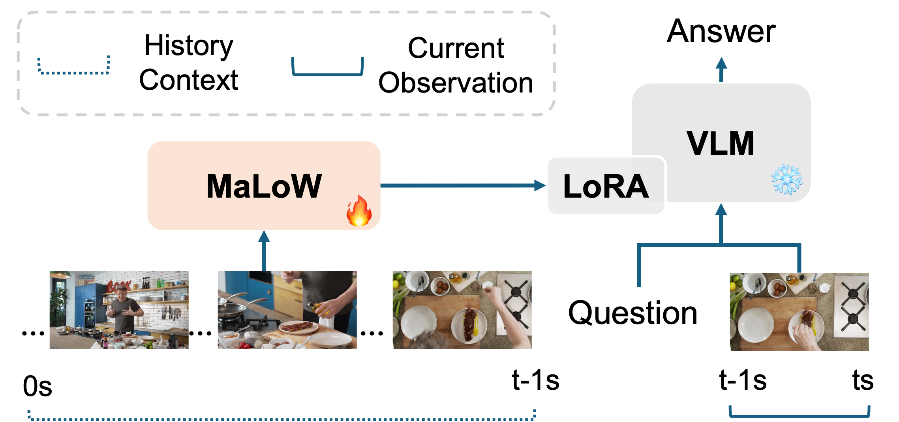
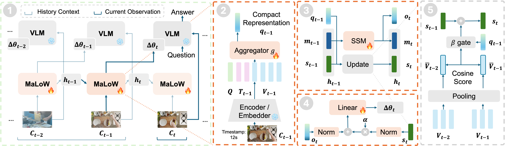

<p align="center">
  
</p>


<h1 align="center">💾 MaLoW: Memory as LoRA Weights</h1>
<h3 align="center">Memory as Weights: Internalizing Long-Term History for Streaming Videos</h1>


<p align="center">
  <a href="https://arxiv.org/abs/2610.22070"></a>
  <a href="https://dragonlzm.github.io/MaLoW"></a>
  <a href="https://huggingface.co/papers/2610.22070"></a>
  <a href="https://huggingface.co/collections/zhuomingliu/malow"></a>
  <!-- <a href="?"></a> -->
</p>

<p align="center">
  <a href="https://scholar.google.com/citations?user=HXOVwRAAAAAJ&hl=en">Zhuoming Liu</a><sup>1</sup>, 
  <a href="https://scholar.google.com/citations?user=v4UwIYMAAAAJ&hl=en">Jinhong Lin</a><sup>1</sup>, 
  <a href="https://scholar.google.com/citations?user=5-PDQ94AAAAJ&hl=en">Lin Zhang</a><sup>1</sup>, 
  <a href="https://scholar.google.com/citations?user=irrbH_IAAAAJ&hl=en">Yiwu Zhong</a><sup>2</sup>, 
  <a href="https://scholar.google.com/citations?user=_y-8nrcAAAAJ">Yin Li</a><sup>1</sup>
<p align="center">
  <sup>1</sup>University of Wisconsin-Madison <sup>2</sup>Peking University</p>
</p>

## Introduction

MaLoW gives vision-language models a memory of earlier observations through evolving, lightweight LoRA weights. A recurrent hypernetwork consolidates history into parameter updates, while the base model receives the current observation and question. MaLoW achieves competitive results across streaming video benchmarks, attains consistent gains over diverse base VLMs, and generalizes to VLA settings. Please refer to [project homepage](https://dragonlzm.github.io/MaLoW) for more details.




## Highlights

- **History as weights:** Carry earlier observations in evolving LoRA weights while keeping the current observation and question as model input.
- **Recurrent streaming memory:** Incrementally consolidate history without revisiting the full video stream.
- **MaLoW-Instruct:** 381K question-answer pairs over 56K videos for training streaming memory.
- **Strong Performance:** On the backward split of OVO-Bench, MaLoW outperforms prior memory approaches by 3.9%-11.8% across different video backbones while incurring only modest latency overhead. Beyond streaming video understanding, MaLoW also generalizes to vision-language-action models, improving the action success rate on Simpler WidowX by 9.3%.


## Updates
- **Oct 30, 2026:** Added support for MaLoW with text-based memory evaluation. See the [evaluation guide](docs/malow_w_text_summary_evaluation.md).
- **Oct 15, 2026:** Released the [checkpoints](#checkpoints) and [evaluation code](#evaluation).

## Contents
- [Install Env](#install-environment)
- [Checkpoints](#checkpoints)
- [Evaluation](#evaluation)
- [Dataset](#dataset)
- [Training](#training)
- [Contact](#contact)
- [Citation](#citation)
- [Acknowledgments and license](#acknowledgments-and-license)

## Install Environment

Please follow the instruction [here](docs/env_prep.md) to finish the environment preparation.


## Checkpoints

Browse all six checkpoints in the **[MaLoW collection](https://huggingface.co/collections/zhuomingliu/malow-6abf1cddce6196fc0bf08a8c)**.

Download only the model you need. These packages contain MaLoW memory weights and the corresponding **Qwen3.5 or Qwen3-VL base model is also required**.
| Model | Checkpoint |
| --- | --- |
| MaLoW (Qwen3.5-9B) | [Hugging Face](https://huggingface.co/zhuomingliu/MaLoW-Qwen3.5-9B) |
| MaLoW (Qwen3.5-4B) | [Hugging Face](https://huggingface.co/zhuomingliu/MaLoW-Qwen3.5-4B) |
| MaLoW (Qwen3.5-4B), last 4 seconds | [Hugging Face](https://huggingface.co/zhuomingliu/MaLoW-Qwen3.5-4B-Last4s) |
| MaLoW (Qwen3-VL-4B), last 8 seconds | [Hugging Face](https://huggingface.co/zhuomingliu/MaLoW-Qwen3-VL-4B-Last8s) |
| MaLoW (Qwen3.5-2B) | [Hugging Face](https://huggingface.co/zhuomingliu/MaLoW-Qwen3.5-2B) |
| MaLoW (Qwen3.5-0.8B) | [Hugging Face](https://huggingface.co/zhuomingliu/MaLoW-Qwen3.5-0.8B) |


For example, download the MaLoW Qwen3.5-9B video checkpoint and its matching base model:

```bash
python -m malow.download --model video-9b --output checkpoints --with-base
```

For video, choose `video-9b`, `video-4b`, `video-4b-last4s`, `video-qwen3vl-4b-last8s`, `video-2b`, or `video-0.8b`. The `video-4b-last4s` variant uses four current-observation frames from the last four seconds. `video-qwen3vl-4b-last8s` uses eight frames from the last eight seconds with `Qwen/Qwen3-VL-4B-Instruct`, while the remaining MaLoW models use two frames from the last two seconds.

## Evaluation
- [MaLoW evaluation: environment, data, models, and commands](docs/video_evaluation.md)
- [MaLoW with text-based memory evaluation: environment, data, models, and commands](docs/malow_w_text_summary_evaluation.md)

Video evaluation also supports question-driven memory updates (`--eval-mode interactive`) and fixed-gap rollout (`--eval-mode fixed-gap --rollout-step-seconds 2`). The original offline evaluator remains the default. See the [interactive evaluation commands and frame-resolution guide](docs/video_evaluation.md#6-interactive-evaluation).


## Dataset
> **Coming soon:** Training data will be released. Stay tuned!

## Training

> **Coming soon:** Training code will be released. Stay tuned!

## Contact
Zhuoming Liu (zliu2346@wisc.edu)

## Citation

```bibtex
@misc{liu2026memoryweightsinternalizinglongterm,
      title={Memory as Weights: Internalizing Long-Term History for Streaming Videos}, 
      author={Zhuoming Liu and Jinhong Lin and Lin Zhang and Yiwu Zhong and Yin Li},
      year={2026},
      eprint={2610.22070},
      archivePrefix={arXiv},
      primaryClass={cs.CV},
      url={https://arxiv.org/abs/2610.22070}, 
}
```

## Acknowledgments and license

MaLoW builds on [Qwen3-VL](https://huggingface.co/Qwen/Qwen3-VL-4B-Instruct), [Qwen3.5](https://huggingface.co/collections/Qwen/qwen35), [Doc-to-LoRA](https://github.com/SakanaAI/doc-to-lora), [Transformers](https://github.com/huggingface/transformers), and [LLaMA-Factory](https://github.com/hiyouga/LLaMA-Factory). We thank the [OVO-Bench](https://github.com/JoeLeelyf/OVO-Bench), [StreamingBench](https://github.com/THUNLP-MT/StreamingBench), and [SimplerEnv](https://github.com/simpler-env/SimplerEnv) authors.

Original contributions are released under [Apache-2.0](LICENSE). Base models and benchmark assets retain their upstream licenses.
